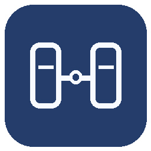
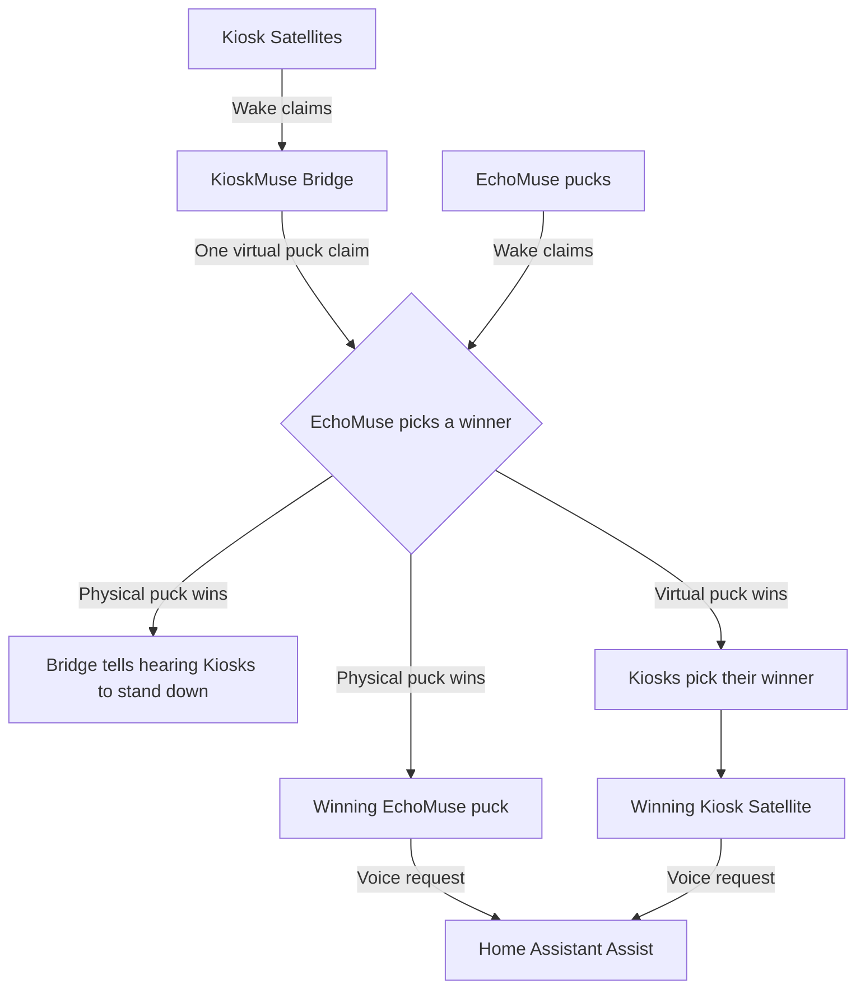
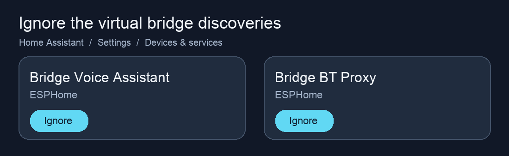

# KioskMuse Bridge

Use one wake word across EchoMuse pucks and Kiosk Satellites, with one device answering when both systems hear it.

## Features

- **One reply across both systems.** Use the same wake word on EchoMuse pucks and Kiosk Satellites.
- **Automatic Kiosk discovery.** Approve a single virtual puck in stock EchoMuse to represent the Kiosks on your network.
- **Adjust which device wins.** Tune microphone level offsets for the bridge or an individual Kiosk.

## How it works

The winning device runs its normal Assist conversation and plays the answer. The bridge handles wake claims and arbitration.

Show the wake arbitration diagram

## Setup

1. Run the bridge and stock EchoMuse on the same Home Assistant OS host. Enable on-device wake detection and arbitration in EchoMuse. Use the same wake word on both systems.
2. Enable **Wake word arbitration** on each Kiosk. Start with the default **400 ms** window.
3. Use the button above to add the repository. Install and start **KioskMuse Bridge** from the Home Assistant Apps store, then approve its pending `KIOSK-…` puck in **EchoMuse**.
4. In **Settings → Devices & services**, choose **Ignore** for **Bridge Voice Assistant** and **Bridge BT Proxy** if they appear. Check the bridge log for **Virtual puck is ready to arbitrate**.

## Tune

Try the wake word near each device. If Kiosks win too often, lower `level_offset_db` in the bridge by 5 dB. Raise it if the pucks win too often. Restart the bridge after changing its settings. For one Kiosk, use its own **Arbitration offset**.

[App documentation and troubleshooting](kiosk_puck_bridge/DOCS.md)

## Contributing

Pull requests are welcome. Describe the change and how you tested it.

[MIT license](LICENSE). OpenAI Codex assisted with development, testing, and documentation.
